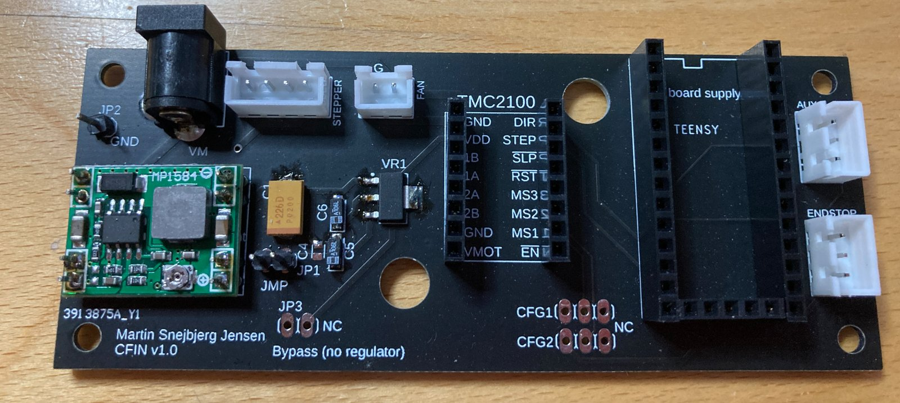
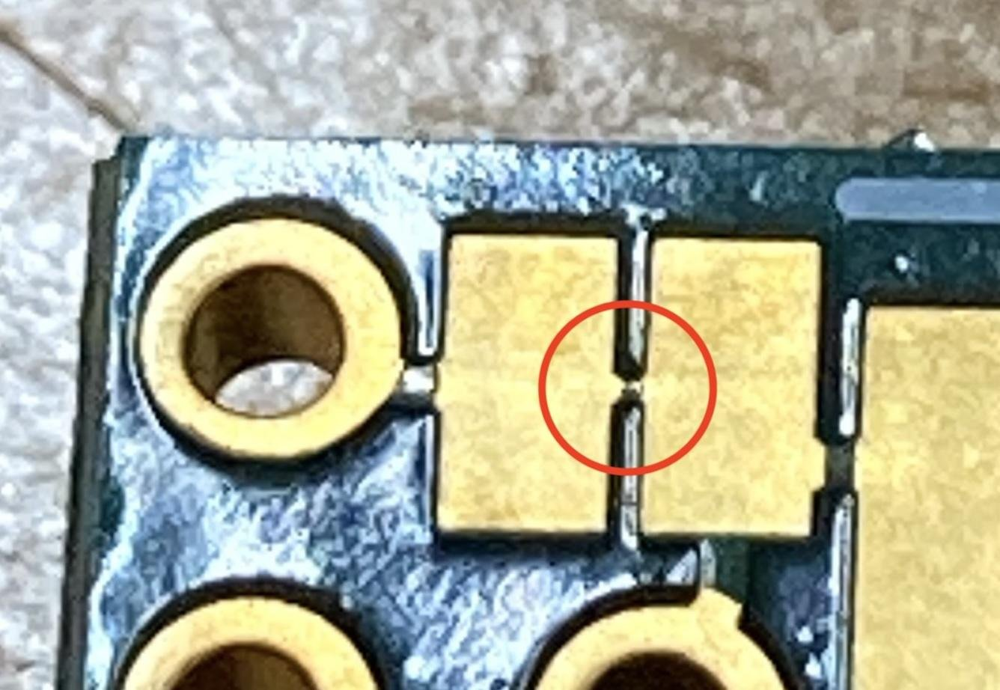
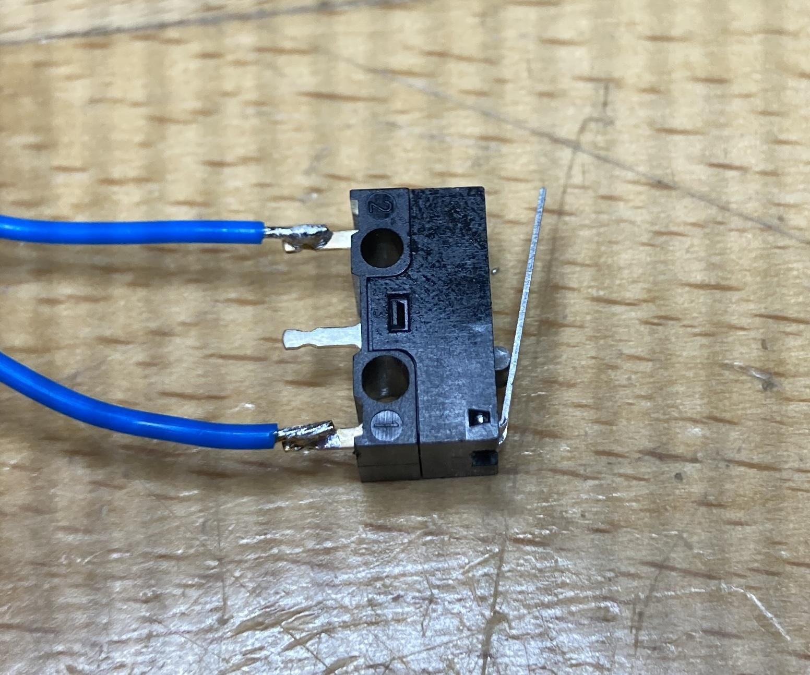
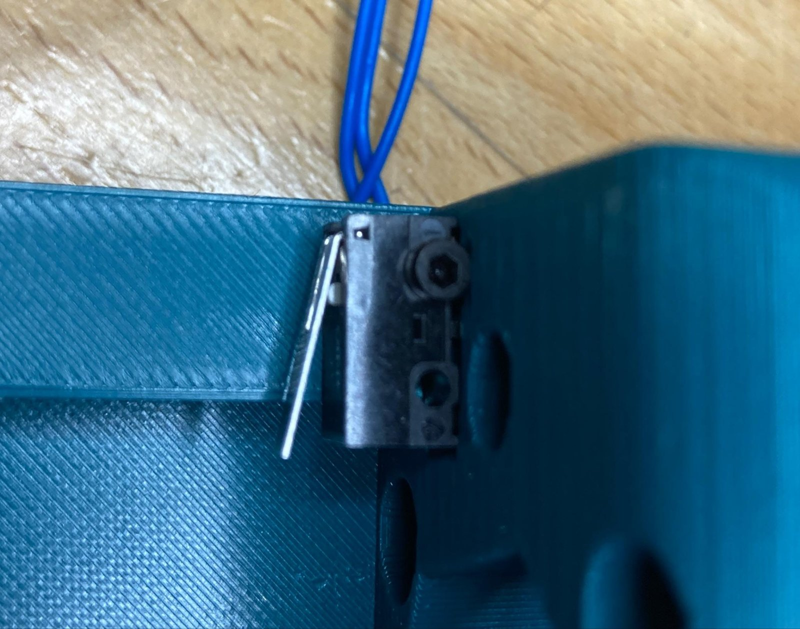
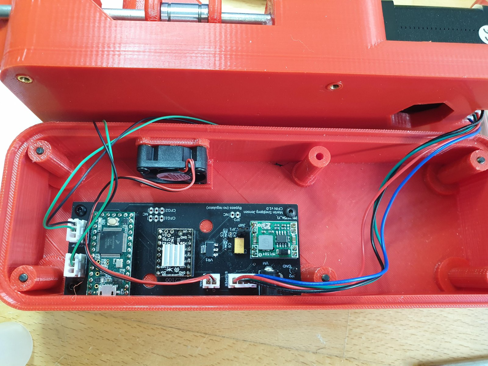
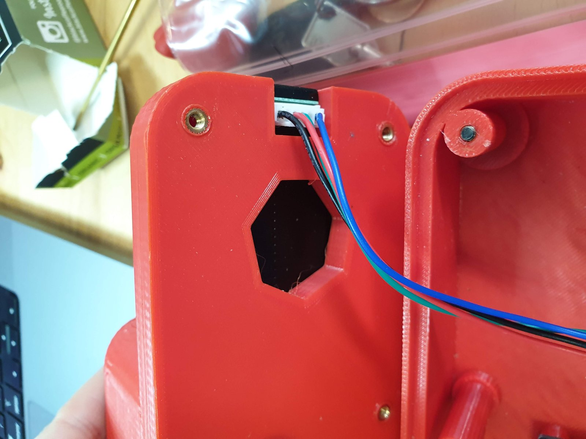

# Building the legacy (v3-0) device

Adapted from the 2022 build guide. For a new build, follow this page for the **housing
and mechanics**, and [RRST 2.0 → Electronics](../v2/electronics.md) for the board.

## Step 1: Gather parts and order the PCB

Check you have everything on the [parts list](parts.md). Order the PCB from any PCB
service (e.g. PCBWay) on standard materials, using the Gerber files in
`hardware/legacy/version_3-0/pcb/CAMOutputs/`. The lab ordered bare boards and mounted
the surface-mount parts itself. You can also upload the pick-and-place files
(`CAMOutputs/Assembly/`) and have the manufacturer assemble them. **Order a few spare
boards** in case one is damaged during assembly.

{ width="600" }

## Step 2: 3D-print the shell and wedge

The shell has two parts, top and bottom, plus a wedge. The STLs are in
`hardware/legacy/version_3-0/3d_print_files.zip`: `device_top`, `device_bottom`, `wedge`,
`device_drawer` and `coupler1–4`. Print in **PETG**. PLA softens at a lower temperature
and can deform if the motor or electronics warm up. The wedge needs supports; the other
parts usually don't, depending on the printer.

!!! todo "TODO(parts): print settings"
    Record layer height, infill, wall count and support settings that are known to work.

## Step 3: Mount the components on the PCB

Use the PCB layout diagram (`hardware/legacy/version_3-0/Connection board v10.pdf`) to
place each component. Soldering is easiest with a hot plate
([Instructables: SMD soldering with a hot plate](https://www.instructables.com/SMD-SOLDERING-101-USING-HOT-PLATE-HOT-AIR-BLOWER-S/)),
done by someone with experience. A soldering iron also works but is finicky
([Instructables: surface-mount soldering](https://www.instructables.com/Soldering-and-Desoldering-Surface-Mount-Components/)).

A jumper on the board separates the adjustable power supply from the fixed 3.3 V LDO.

1. Leave the **jumper, driver and Teensy out**, power the board, and **adjust the
   step-down supply to 5 V**.
2. Fit the jumper.
3. The Teensy is powered from the board, not from USB, so **cut the USB-power trace** on
   the Teensy (the pads circled below). You can program the Teensy first (see
   [Programming](programming.md)), then cut the trace and mount it.

   { width="400" }

4. **Fan:** check the polarity when fitting the connector. Fans differ.
5. Fit the driver last. On the TMC2100, set its regulator to **0.8 V**, as the parts list
   specifies.

### Endstops

Each endstop uses two pins: **S** (signal) and **G** (ground). The connector labelled
*endstop* on the PCB is the **zero (min) endstop**, next to the stepper. The **max
endstop** goes into the **aux** port. On both switches, solder the wires to the
**outer** pins:

{ width="400" }

Mount each switch with the lever facing as shown, using an M2×10 self-tapping screw:

{ width="500" }

## Step 4: Assembly

1. Measure the steel rods and leadscrew for your housing and cut them to length.
2. Put the leadscrew nut inside the wedge. Thread the wedge onto the leadscrew, and onto
   the rods using the linear bearings.
3. Place the assembly in the top shell.
4. Put the finished PCB in the bottom shell and connect it to the motor in the top shell.

{ width="500" }

{ width="400" }

!!! todo "TODO(Martin): mechanical details"
    Document rod and leadscrew cut lengths, the 608 bearing and damper positions, and how
    the "fine-tune screw" on the back of the wedge sets the endpoints. The task code
    comments describe it: counter-clockwise retracts, clockwise advances.
