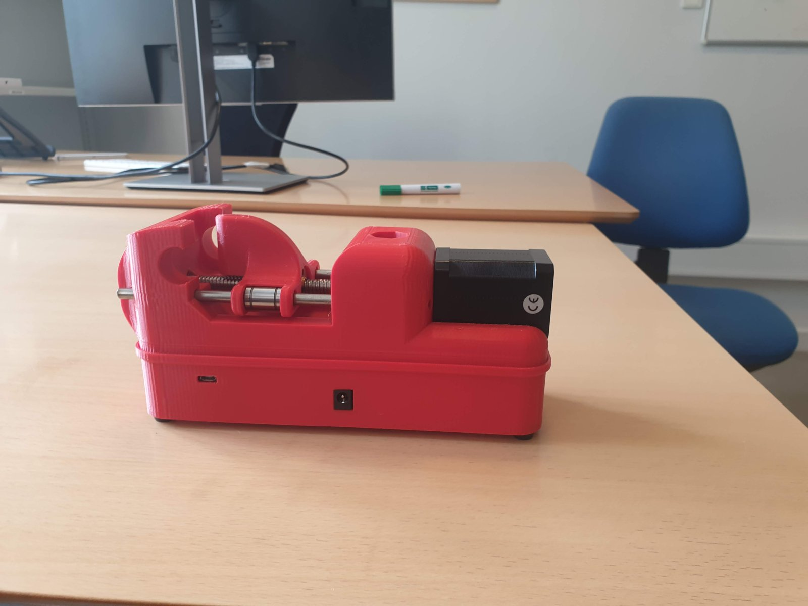

# Legacy device (2021–2022)

These pages document the device as published in Nikolova et al. (2022), and the v3-0
hardware revision of May 2022. They are adapted from the 2022 "RRST Build and Set up"
guide, with its photos.

!!! warning "Not recommended for new builds"
    Two core parts are no longer made: the **Teensy 3.1** microcontroller and the
    **E3D Super Whopper** stepper motor
    ([issue #1](https://github.com/embodied-computation-group/RespiroceptionMethodsPaper/issues/1)).
    Other parts may be hard to find. For a new device, build the mechanics from these
    pages and the electronics from [RRST 2.0](../v2/index.md). See
    [Parts sourcing](../parts-sourcing.md) for current availability and replacements.

## Hardware revisions

| Revision | Period | Electronics | Endstops | Files |
|---|---|---|---|---|
| **v2-2** | 2021 (methods-paper data) | Teensy 3.1 + TMC driver, hand-wired | 1 (min) | `hardware/legacy/version_2-2/3dPrintStlFiles/` (vice clamp, vice top, drawer) |
| **v3-0** | May 2022 → | Teensy 3.1 + TMC2100 on the CFIN connection board (PCB v1.0, CAM files v24) | 2 (min + max) | `hardware/legacy/version_3-0/`: 3D-print STLs, PCB Gerbers, layout PDF |

The task code matches the hardware: `RRS_2-2` for devices from April 2022 or earlier,
`RRS_3-0` for devices from May 2022 onwards.

{ width="600" }

## Pages

1. [Parts](parts.md): the 2022 parts list, with current availability flags.
2. [Build](build.md): printing, PCB assembly, endstops and mechanical assembly.
3. [Programming](programming.md): uploading the Teensy 3.1 firmware with Arduino and
   Teensyduino.

The breathing circuit, room setup, running the task and hygiene are the same for both
generations: see **Lab setup**.
