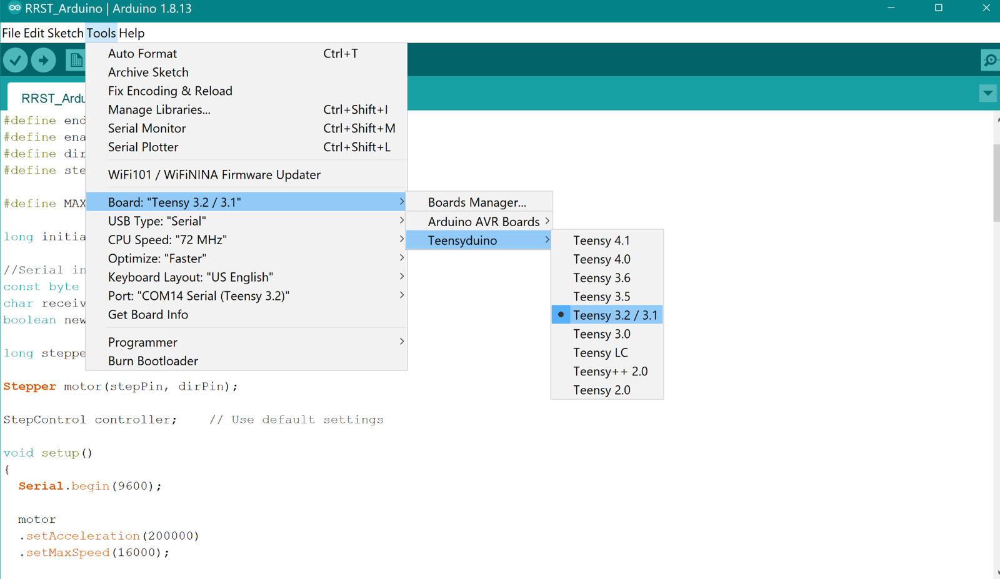
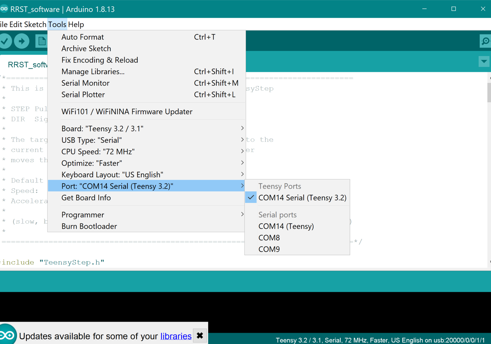

# Programming the legacy device (Teensy 3.1)

The legacy firmware runs on a Teensy 3.1/3.2 and is uploaded with the Arduino IDE plus
Teensyduino. The sketches are in `firmware/legacy/`:

| Sketch | Hardware | Protocol |
|---|---|---|
| `RRST_Arduino.ino` | v2-2 (single endstop) | Bare target position as a number |
| `Resp_valve_3-0.ino` | v3-0 (two endstops) | Single-letter commands (`c` calibrate, `a` move, …) |

!!! note "2.0 devices"
    Teensy 4.0 devices use different firmware and are flashed with the Control Panel.
    See [RRST 2.0 → Firmware](../v2/firmware.md).

## Requirements

- A Windows PC with the **Arduino IDE**. Use the classic installer ("Windows, Win 7 or
  newer"), not the Microsoft Store app. The 2022 guide used Arduino 1.8.x.
- **Teensyduino** from [PJRC](https://www.pjrc.com/teensy/td_download.html), installed into
  Arduino. Restart Arduino afterwards.
- The **TeensyStep** library (both sketches), plus **SerialMenuCmd** for
  `Resp_valve_3-0.ino`. Install both via **Sketch → Include Library → Manage
  Libraries**.

!!! todo "TODO(Martin): versions"
    Record the Arduino, Teensyduino and TeensyStep versions known to build the legacy
    sketches. Current Arduino 2.x with the Teensy board package may also work but hasn't
    been tested.

## Upload

1. Connect the device to power and to the PC.
2. Open the sketch in Arduino. Arduino asks to move it into a folder with the same name;
   accept.
3. **Tools → Board → Teensyduino → Teensy 3.2 / 3.1**

   { width="600" }

4. Check the other settings under **Tools**:
    - USB Type: **Serial**
    - CPU Speed: **72 MHz**
    - Optimize: **Faster**
    - Port: **COMxx Serial (Teensy 3.2)**

   { width="600" }

   If Teensy isn't listed under Board, Teensyduino didn't install correctly.

5. Click **Upload** (the arrow button).
