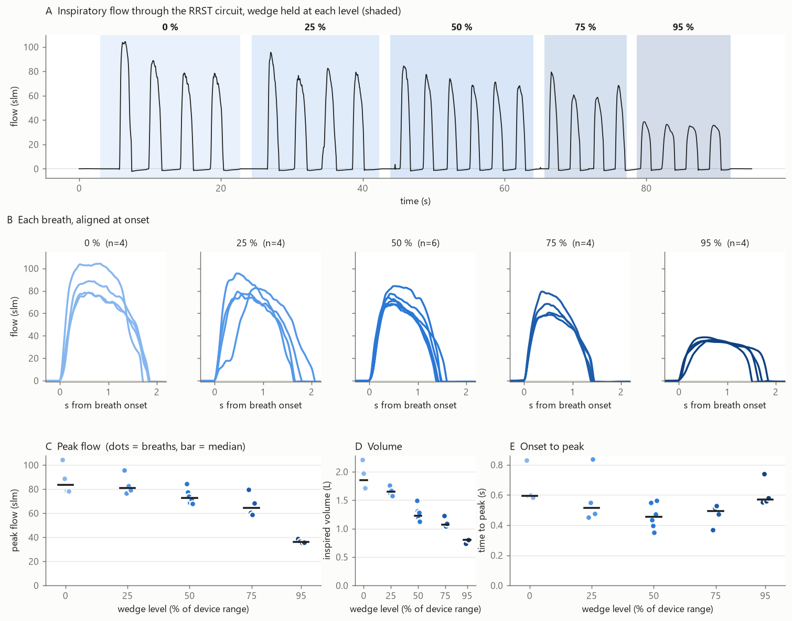

# Airflow sensor (optional)

A digital flow sensor at the inlet of the breathing circuit records every inhalation
at 1 kHz: how much air the participant draws through the circuit on each trial, and
how the obstruction changes it. It works with any device generation and is recorded
with the task markers and physiology over LSL (see [Recording physiology and
airflow](recording.md)). First used on the stim laptop on 2026-10-28.

!!! todo "TODO(photo): sensor in the circuit"
    Photo of the SFM3019 at the inlet end of the circuit, arrow visible, with the
    SensorBridge and cables.

## Parts

| Part | Specification | Qty | Notes |
|---|---|---|---|
| Flow sensor | **Sensirion SFM3019-240** | 1 | Thermal mass-flow sensor, −10 to +240 slm, ±2 % of reading typical, I²C, flow and temperature. Calibrated for air, O₂ and mixtures. Available cheaply on Amazon (Niia Nikolova). The Aarhus unit is serial 2033002297 |
| USB bridge | **Sensirion SEK-SensorBridge** | 1 | USB to I²C, two sensor ports, powers the sensor (set to 3.3 V by the software) |
| Sensor cable | `TODO(parts)`: SensorBridge to SFM3019 cable (part of the SEK-SFM3019 kit?) | 1 | |
| Tube adapters | `TODO(parts)`: fittings between the silicone tube and the sensor's ports | 1–2 | The SFM3019 comes with 22 mm medical cone or generic ports |

Units: **slm**, standard litres per minute, referenced to 20 °C (`sl(20)/min` in
Sensirion's software).

## Placement

Fit the sensor at the **open inlet end** of the circuit, before the silicone tube
that the wedge compresses, with the **arrow on the sensor pointing toward the
participant** (the inhalation direction):

**free air → SFM3019 → silicone tube (through the device) → 22 mm tube → T-valve →
mouthpiece**

- **It still measures the obstruction.** The circuit is a single tube with no
  branches, so all inhaled air passes the sensor, and the flow at the inlet equals the
  flow at the mouth. The wedge adds resistance to the whole path and lowers the flow
  everywhere, including at the sensor.
- **Only inhaled air reaches it.** The T-valve sends exhaled air out of its own port,
  so the sensor sees room air: no condensation and no hygiene concern for the sensor.
  Only inhalation is measured well anyway: the SFM3019-240 reads down to −10 slm in the
  reverse direction.
- **Clean inflow.** Air enters straight from the room, not from the narrowed tube
  behind the wedge.
- **Leaks bypass it.** Air drawn in between the sensor and the mouth (a loose coupler,
  a T-valve diaphragm that doesn't seal) is not measured. Check the seal by blocking
  the sensor's open end: no air should get through.

!!! note "Small backflow after every breath"
    After each breath, flow reads about −1 to −2 slm for 1–2 s while the participant
    exhales: a little air pushes back past the inhale diaphragm as it closes. This is
    normal for the T-valve and doesn't affect the inhalation measures.

!!! note "Keep the circuit the same across sessions"
    The sensor adds a small fixed resistance to every breath. Keep it in the circuit
    for every participant and session of a study (or never use it), so thresholds stay
    comparable.

## Software setup (Windows, once per PC)

1. **Driver.** Install Sensirion's
   [SEK-ControlCenter](https://sensirion.com/products/sensor-evaluation/control-center/)
   as an administrator, and accept the **additional libraries** offered at the end of
   the setup wizard. They contain the SensorBridge USB driver. Without it, Device
   Manager shows the bridge as `EKS2` with error code 28 and no COM port. After
   installing, unplug and replug the bridge: it appears as
   `SEK-SensorBridge (COMx)`.
2. **Check in ControlCenter** that the bridge and sensor show up and that the flow
   trace moves when you breathe through it. Then **close ControlCenter**: only one
   program can use the bridge at a time.
3. **Streaming to LSL.** The `plux-lsl` tools include `flow_lsl.py`, which uses
   Sensirion's Python drivers (`pip install sensirion-sensorbridge-i2c-sfm`). Check the
   connection with:

    ```
    .venv\Scripts\python.exe flow_lsl.py --list
    ```

    It finds the bridge by its USB ID, finds the sensor on either bridge port, and
    prints a 1 s reading. With nothing breathing through it, flow should read
    0.0 ± 0.1 slm.

The Physio Recorder's **RRST** preset starts the flow stream automatically. See
[Recording physiology and airflow](recording.md).

!!! warning "Set the RRST device's port by name"
    The SensorBridge adds a serial port, so the task's `cfg.device.port = "auto"` stops
    working (it refuses to guess between ports). Set the RRST device's port, for example
    `cfg.device.port = "COM7"`.

## How it samples

The SensorBridge reads the sensor on its own clock every 1 ms and buffers the
readings, and `flow_lsl.py` collects them about every 20 ms. Samples are therefore
evenly spaced even when Windows is busy. The bridge clock runs at about 1006 Hz
against a nominal 1000 Hz; the LSL timestamps follow the real rate. Each sample
carries a counter (`nSeq`), so any lost sample shows up as a gap.

| Channel | Unit | |
|---|---|---|
| `nSeq` | samples | bridge sample counter; gaps = lost samples |
| `flow` | slm | positive = inhalation |
| `temp` | °C | sensor temperature; rises a little as it warms up |

## Bench check: flow against wedge level

`bench/flowLevels.m` calibrates the device, then holds the wedge at 0, 25, 50, 75 and
95 % of its range while the operator breathes through the circuit, and marks each hold
on the `RRST` marker stream. **Moves the wedge.**

```matlab
cd <repo>/bench
flowLevels("COM7")
```

First run, 2026-10-28 (one person, 4–6 breaths per level, levels in increasing order,
effort not controlled):

| Wedge level | Peak flow (median) | Volume per breath (median) |
|---|---|---|
| 0 % | 84 slm | 1.85 L |
| 25 % | 81 slm | 1.65 L |
| 50 % | 73 slm | 1.23 L |
| 75 % | 65 slm | 1.07 L |
| 95 % | 36 slm | 0.80 L |

Flow falls steadily as the wedge closes. At 95 % the breath becomes a flat plateau at
about 35 slm: the obstruction limits the flow however hard the person pulls.

{ width="800" }

!!! note "Flow is not resistance"
    A participant who feels the obstruction can pull harder and keep the same flow, so
    flow alone doesn't measure the obstruction. Resistance is the pressure drop divided
    by the flow, which needs a pressure sensor near the mouth as well.
    `TODO(pressure)`: the lab's pressure sensor.

## Live feedback check

The kids task can drive the screen from the flow stream (breath feedback). Before a
pilot, `bench/flowFeedbackCheck.m` checks that the stream reaches MATLAB quickly
enough. It needs only the `Flow` stream: **no device, no calibration**, the wedge
does not move.

```matlab
cd <repo>/bench
flowFeedbackCheck              % 20 s in a small window
flowFeedbackCheck(60, SmallWindow=false)   % 60 s, full screen on the task screen
```

It checks the sensor at rest (nobody breathing for the first second), then shows a
bar that follows the flow from 0 to 60 slm. Breathe through the circuit and watch
the bar rise with each inhalation. Esc stops early. Every second the console prints
the **lag**: the time from the newest flow sample to the screen refresh that first
showed it. At the end it prints the median and 95th-percentile lag, the sample rate,
any gaps (lost samples) and the flow at rest.

| Number | Expected | If not |
|---|---|---|
| Sensor check | `Airflow sensor OK: 0.0 slm at rest` | See the messages in Troubleshooting |
| Sample rate | about 1005 Hz | Under 900 Hz: the bridge or USB is struggling; restart the flow stream |
| Gaps | 0 | A few in a long run are harmless; many: unplug and replug the SensorBridge |
| Flow at rest | 0.0 ± 0.1 slm | A steady offset above 1 slm: leak or draught at the inlet |
| Lag, median | `TODO(measure)`: about 20 to 40 ms full screen | Over 60 ms: check the flow stream runs on this PC and nothing else is busy |

First smoke test, 2026-10-30 (stim laptop, flow stream from `flow_lsl.py`, nobody on
the circuit, no window): 1005 Hz, no gaps, flow at rest 0.02 slm (SD 0.03), and the
newest sample was **4 ms old** (median; 95th percentile 8 ms) when MATLAB read the
stream at 60 Hz. The screen adds the wait for the next refresh and the refresh itself,
so the full lag is expected at one to two frames more. The lag on screen is still to
be measured with someone breathing. In a small window, Windows' compositor adds about
a frame; measure the task's lag full screen on the task screen.

!!! note "Stream times can step back by up to 1 ms"
    `flow_lsl.py` stamps the newest sample of each chunk when it asks the bridge, and
    the earlier samples are spaced at the nominal 1 ms while the bridge runs at about
    1005 Hz. At chunk boundaries a timestamp can be up to about 1 ms earlier than the
    one before. Compute breath volume from the samples and the sample rate, not from
    the timestamp differences.

## Troubleshooting

| Problem | What to do |
|---|---|
| `SensorBridge not found` | USB cable plugged in? Driver installed (see above)? |
| `COMx is in use by another program` | Close SEK-ControlCenter, or another flow recording that is still running. |
| `no flow sensor on either of its ports` | Push the sensor cable fully into the bridge. |
| The flow stream starts but never says "Streaming", or the program can't be closed | The bridge's USB link has hung, which happened after re-plugging other USB devices. **Unplug the SensorBridge for 5 s and plug it back in**, then start again. |
| Flow `REVERSE FLOW` or `OUT OF RANGE` | Sensor mounted backwards: the arrow must point toward the participant. |
| Flow `CONSTANT FLOW` | Air moving all the time: a leak or a draught at the inlet. |
| Flow `no breaths through the circuit` | Normal between trials. During setup: mouthpiece in? Circuit sealed? |
