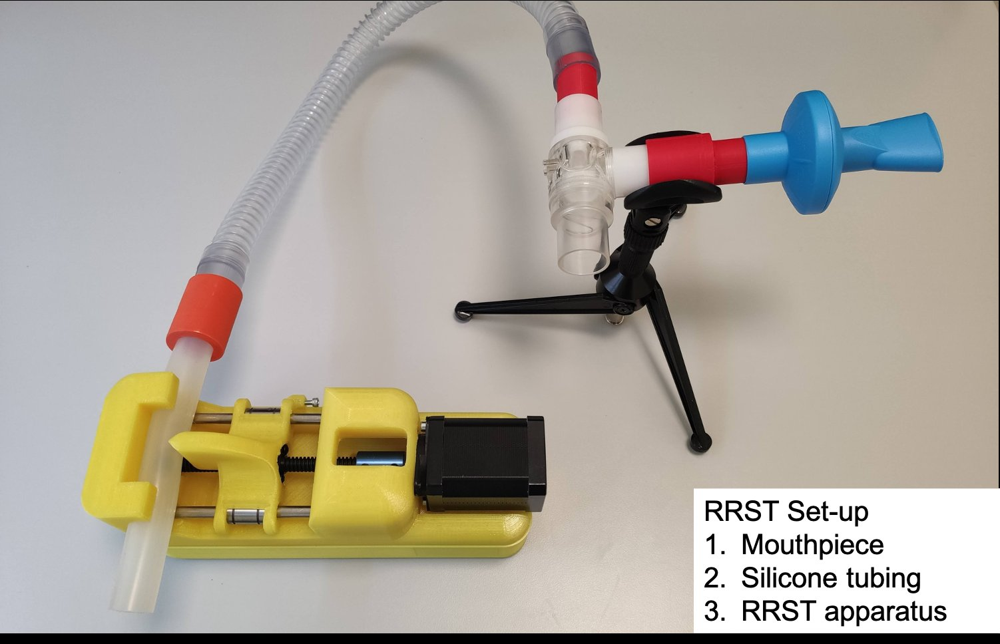
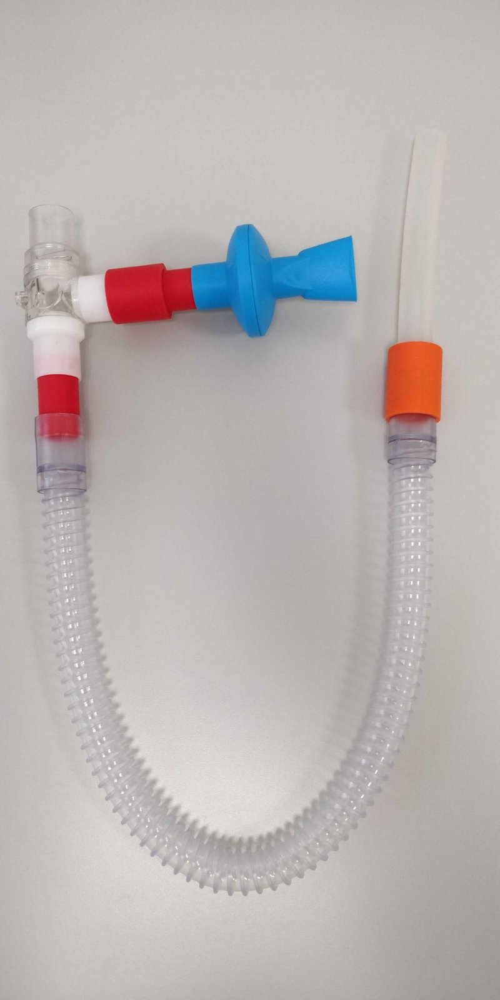
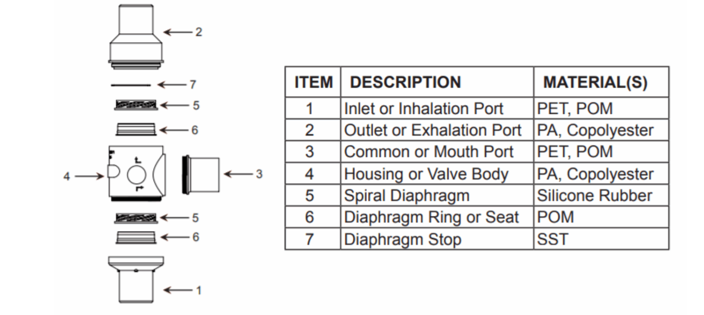
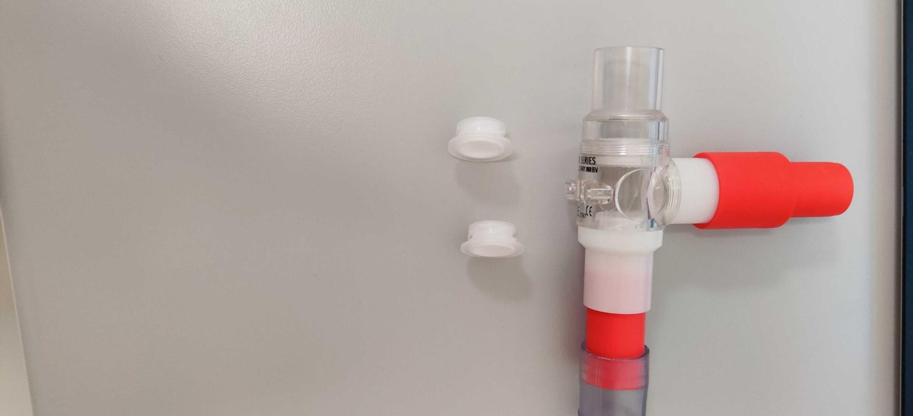
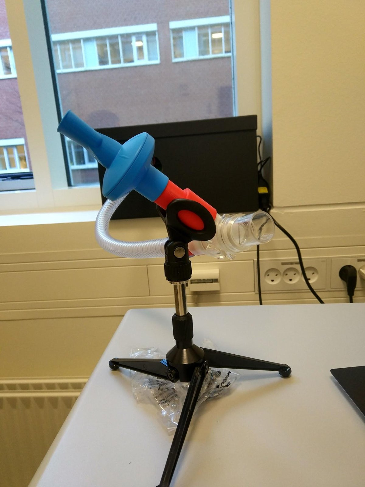

# Breathing circuit

The same for every device generation. Parts are listed under **Accessories** in the
[parts list](../legacy/parts.md#accessories-both-generations).

{ width="600" }

## Assembly

The circuit runs: **free air → silicone tube (through the device) → 22 mm smoothbore
tube → Hans Rudolph T-valve → mouthpiece coupler → POWERbreathe filtered mouthpiece**.

- Inhaled air must come **through the silicone tube**, the end the device compresses.
- Exhaled air leaves through the **free port of the T-valve**, so the participant never
  re-breathes from the circuit.
- Optional: an [airflow sensor](airflow-sensor.md) at the free-air end, before the
  silicone tube, records every inhalation.

{ width="300" }

## T-valve (Hans Rudolph 1410)

{ width="600" }

| Item | Part | Material |
|---|---|---|
| 1 | Inlet / inhalation port | PET, POM |
| 2 | Outlet / exhalation port | PA, copolyester |
| 3 | Common / mouth port | PET, POM |
| 4 | Housing / valve body | PA, copolyester |
| 5 | Spiral diaphragm | silicone rubber |
| 6 | Diaphragm ring / seat | POM |
| 7 | Diaphragm stop | SST |

When reassembling after cleaning, make sure **both spiral diaphragms (5) face the same
direction**. Assembled as shown, the mouthpiece goes on port 3, the clear exhale valve
is at the top, and the inhale tube attaches at the bottom.

{ width="400" }

## Holding the mouthpiece

A table-top microphone stand holds the coupler between the mouthpiece and the T-valve
in front of the participant.

{ width="300" }

!!! todo "TODO(parts): coupler part number"
    Identify the coupler between the POWERbreathe mouthpiece and the T-valve, and the
    connector between the silicone tube and the 22 mm tubing (possibly the printed
    `coupler1–4.stl`).
