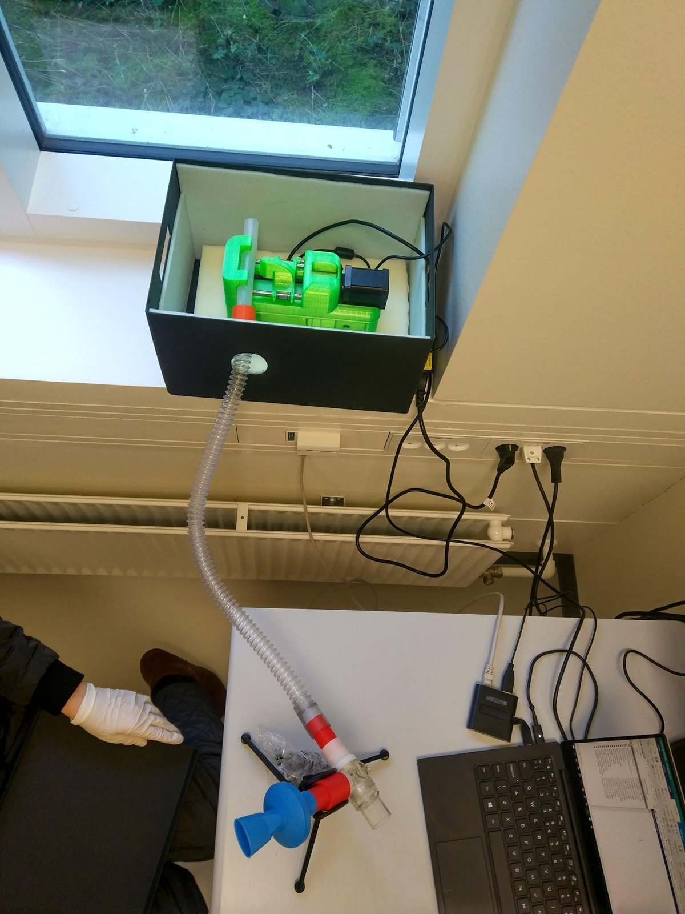

# Room setup and cue masking

The participant must judge breathing resistance from breathing alone, not from motor
sound, vibration or sight of the device. The methods paper's masking was settled by
piloting, including the motor's acceleration settings and the choice of noise.

!!! warning "Re-pilot masking on 2.0 devices"
    The 2.0 driver, motor, speed and acceleration all change how the device sounds and
    vibrates. Check masking again on every new device before data collection (see
    [Bench check, step 5](../v2/bench-check.md#5-masking-check)).

{ width="400" }

## Checklist

- [ ] The device sits **inside a box**, on **thick foam**, so the participant can't see
      it and vibration is damped.
- [ ] The box is on a **separate surface** from the participant's desk.
- [ ] The USB and power cables run through a hole in the box to the stimulus PC and the
      mains.
- [ ] The participant wears **over-ear headphones** playing continuous masking noise
      (rain).
- [ ] The mouthpiece is on a microphone stand at a comfortable height. A
      height-adjustable desk helps.
- [ ] Moves between trials go to a **random rest position**, so the duration of the next
      move doesn't reveal the stimulus.

## Masking noise

The 2022 setup played a 60-minute rain recording, `32-Waterfall-60min.wav`, through the
task. It's too large for the repository and is kept on
[Google Drive](https://drive.google.com/file/d/15GiyaXsXDPdsLH4fSebo1JtvHKyAbYAA/view).
For legacy task versions, place it in `task/helpers/audio/`.

!!! todo "TODO(toolkit): generated masking noise"
    RRST 2.0 will generate the masking noise in Psychtoolbox instead of shipping a
    recording, so no extra download is needed. Choose the noise spectrum and level so it
    masks the motor (see the [roadmap](../roadmap.md)).
