# Kids version (in development)

!!! warning "In development: not for use with children yet"
    RRST-Kids ("Milkshake Monster") has run on the real device with one adult tester
    only: once before the breath-driven version, once with it (aborted in practice,
    see [First real run with feedback](#first-real-run-with-feedback-2026-10-30-adult)).
    The tutorial has run only in mock sessions, the cue sounds have not been checked
    by ear, the child-facing
    text is English only, and the 85 % cap has not been checked on a flow rig (see
    [Open questions](#open-questions)). It lives on the `kids-variant` branch, in
    `task/RRST_kids/`. The next step is the pilot protocol in
    `docs/kids_pilot_protocol_2026-10-30.md`: an experimenter self-test, then one
    child as a usability check.

A child-friendly RRST for children of about 4-5 years, on the same device and device
layer as RRST 2.0, with the airflow sensor driving the screen.

## The task

A purple monster drinks milkshake through a long straw (the mouthpiece). A cheeky
mouse sometimes pinches the straw, so the slurp feels "squishy". **On each trial the child
takes three slurps at the same level and says whether the mouse pinched the straw**: a
yes/no detection task, not the adult two-breath comparison. The experimenter starts the
slurps when the child is ready, and then **the child's own breath drives the monster**:
the airflow sensor sees each slurp, the belly fills, and the milkshake drains a third
per slurp. Nothing is paced, so there is no timed cue to catch. Every answer earns a
star; ten stars finish a milkshake and earn a real sticker from the experimenter.

**Stars are progress, not feedback:** one per answer, right or wrong, toward a cup and
a sticker. Because they say nothing about the answer they are shown in every run,
feedback on or off.

**The tutorial** comes between the story and the practice: free play (the child slurps
as often as they like and watches the belly fill), two demos with no question (three
slurps with the mouse pinching the straw at 80 %, then three with it asleep at 0, each
followed by its reveal), and a bridge screen with the two answer cards, "Now you say:
did the mouse pinch?", for the experimenter to explain. Only then does the practice
ask.

| | Adult RRST 2.0 | Kids |
|---|---|---|
| Judgement | 2 breaths, which was harder (2AFC) | 3 breaths at one level, yes/no ("did the mouse pinch?") |
| Bias | none modelled | yes-bias (guess rate 0-0.5) estimated and marginalised |
| Catch trials | none | 10 at level 0, never first, never two in a row |
| Levels | 0-100 % | 0-85 % in 5 % steps, **hard cap 85 %** |
| Start | Psi's choice | 70 % |
| Jumps | any | at most 15 % above the highest level so far |
| Trials | set by the study | 30 Psi + 10 catch; stops early when SE < 8 after 20 Psi trials |
| Breathing | timed inhale cue | experimenter starts the trial; the **child's breath drives the screen** (airflow sensor): the belly fills with the slurp, each slurp that counts drains a third of the milkshake. The trial goes on after 3 counted slurps; Space ends them early. Without the sensor: a timed animation (1.2 s in, 1.8 s out, x3) |
| Answer | participant clicks | **experimenter clicks** one of two equally nice scene cards ("easy": the mouse asleep; "squishy": the mouse pinching), the one the child names or points at |
| Feedback | none | tutorial demos and practice: the truth after every trial, shown (the mouse pinching or asleep); main trials: none (a star flies into its slot for every answer, right or wrong) |

Why yes/no: a 4-year-old struggles to hold two breaths in memory and compare them.
The cost is that the threshold is a detection threshold that absorbs the child's
yes-bias, not directly comparable to the adult 2AFC threshold, and yes/no needs more
trials for the same precision.

## How the breath drives the screen

The SFM3019 at the circuit inlet streams flow over LSL (stream `Flow`, see
[Airflow sensor](../shared/airflow-sensor.md)). The task reads it and detects each
**slurp**: flow above 3 slm for 50 ms starts one, below it for 150 ms ends it. The
T-valve's small backflow after each breath is negative and never starts a slurp.

- **The belly** shows the current slurp's volume, but saturates: it is full at 40 % of
  the child's reference slurp, so loaded and unloaded slurps both fill it. The screen
  must show *that* the child slurped, not *how hard* it was, or the child could answer
  from the picture instead of the feeling.
- **The milkshake** drains a fixed third per counted slurp, on the slurp's end, with
  bubbles. Never in proportion to the flow.
- **A slurp counts** when its volume is at least 25 % of the reference slurp and at
  least 0.10 L. A counted slurp drains over 1 s (`cfg.timing.drain`); the next one
  can start at once. A smaller one is "weak": the belly goes down, nothing drains, the
  monster tilts its head ("hmm?", never sad) with a soft two-note sound, and the
  child simply slurps again. A "slurp" longer than 6 s is a leak or draught, not
  counted.
- **The reference slurp** is set by the tutorial's free play: the median volume of
  every slurp the sensor saw there (counted or weak), clamped to 0.15-2 L. Before it
  exists the default is 0.6 L, so a small child's free slurps can all be weak against
  it; they still set the reference, and free play never shows the "try again" pose.
  When the glass is empty a new one stands there; Space ends free play once the child
  has slurped (hold Space 1 s to go on without a slurp).

## A trial, frame by frame

The child's screen has no text to read: every state has a pose and a sound. The
small bottom-left line is for the experimenter: first what is happening and which key
goes on (`PRACTICE 3 of 6. Space starts the slurps. ...`, `Trial 5. Space starts the
slurps. No feedback; one star per answer.`), then the story's sentence. The console
prints the same line.

| | |
|---|---|
| 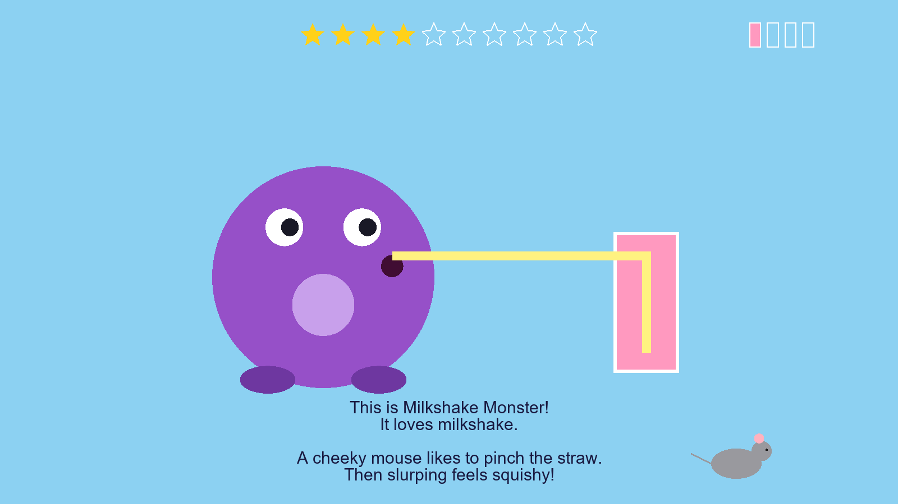 | **Story, beat 1.** Shown once, in three beats; Space moves on from each, so the experimenter tells the story over them. The monster slurps happily, the milkshake drains, then "ahh" with bubbles. Stars (top) and cups (top right) show progress. |
| 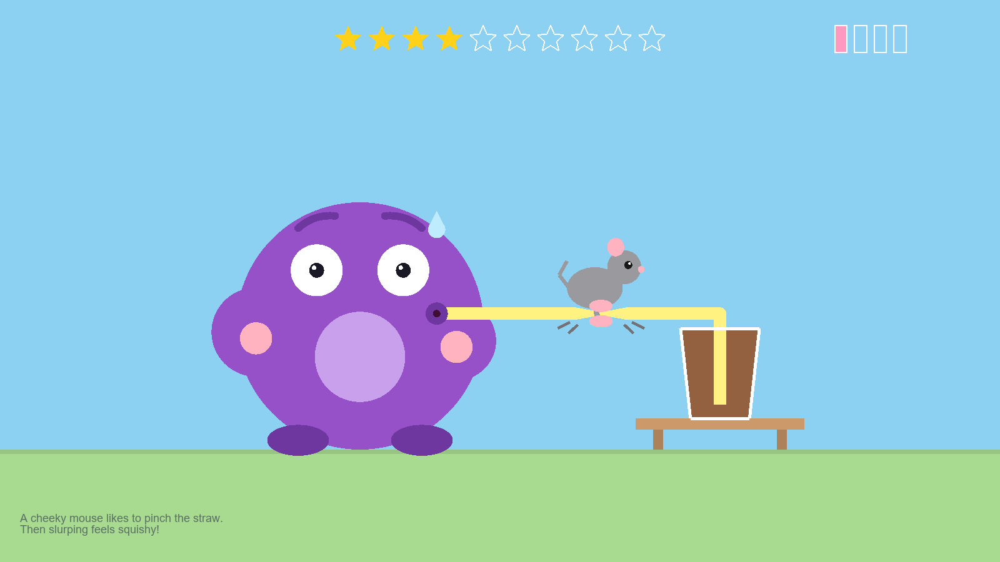 | **Story, beat 2.** The mouse pinches the straw (scamper sound); the monster strains, cheeks puffed. Beat 3: the mouse runs off and the monster relaxes. |
| 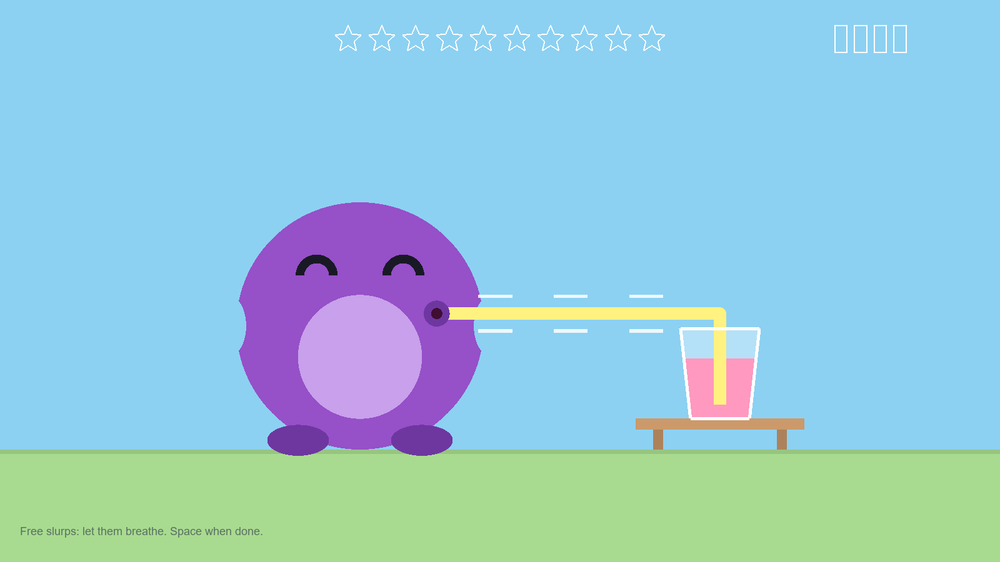 | **Tutorial, free play.** Wedge at 0. The monster waits in its ready pose; every slurp fills the belly and drinks a third of the glass, and an empty glass is replaced at once. The child slurps as often as they like; Space ends it after at least one slurp. Every slurp sets the reference. |
| 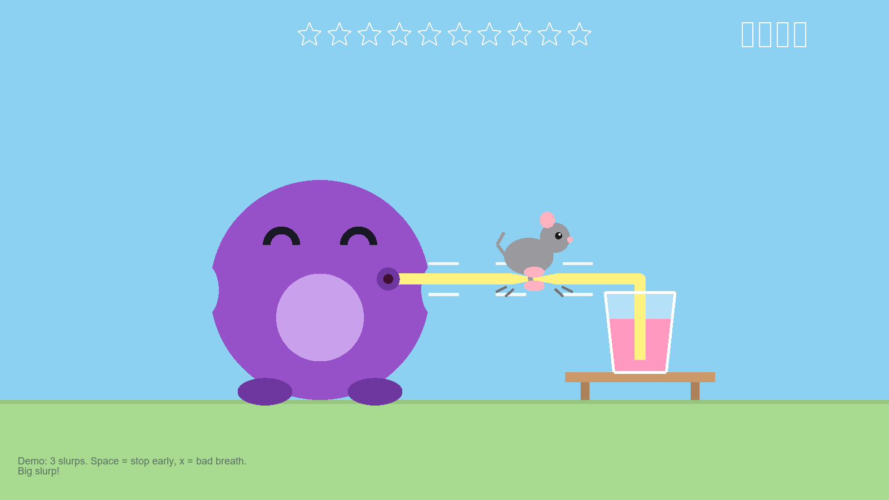 | **Tutorial, demo 1.** The wedge at 80 % and the mouse pinching the straw *while* the child slurps three times: the only time the pinch is seen during breathing. Then the reveal. Demo 2 is the same at 0 with the mouse asleep. Then the two answer cards, explained, and the practice. |
| 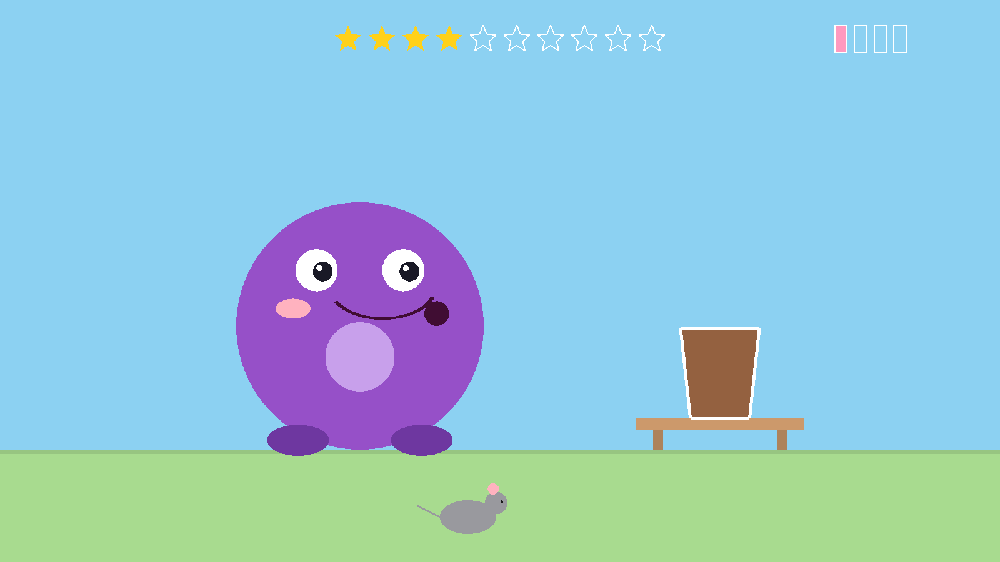 | **Mouse.** The mouse scampers along the bottom (scamper sound) while the wedge moves, at least 1.5 s. On catch trials the wedge moves to 0; the screen is the same. |
| 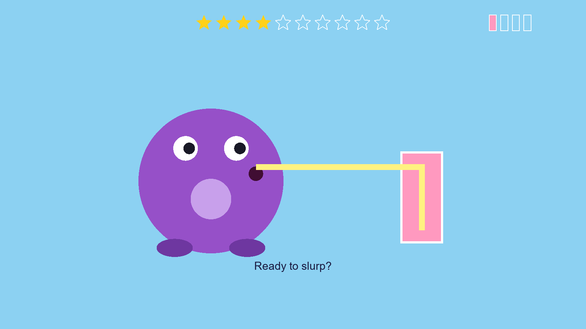 | **Ready to slurp?** The monster looks at the child, eyebrows up, mouth open on a wiggling straw, with a chime. When the child has the mouthpiece in and is ready, the experimenter presses Space. |
| 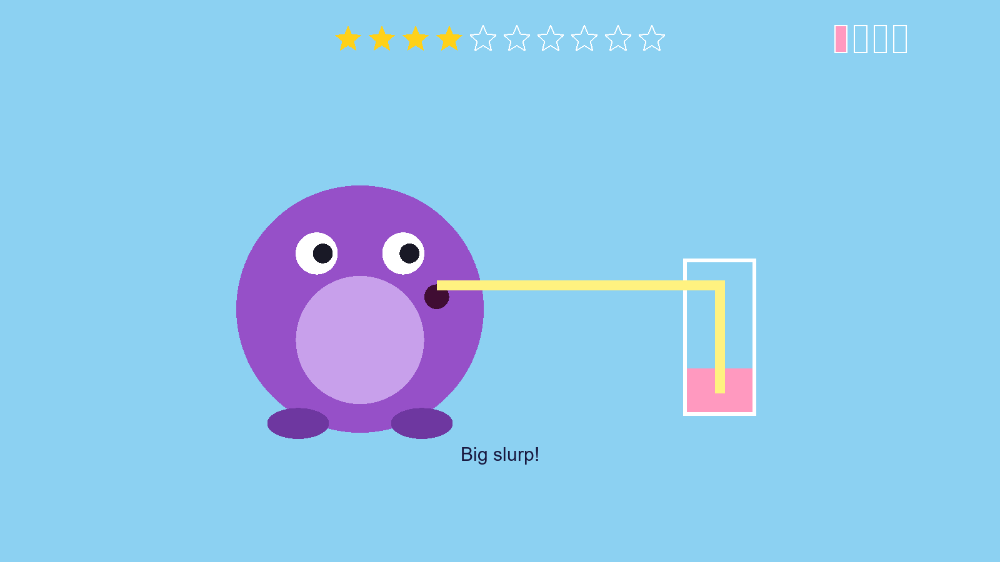 | **Slurp.** As soon as the child inhales, the monster slurps (cheeks in, happy eyes, lines running up the straw) and the belly fills with the breath. |
| 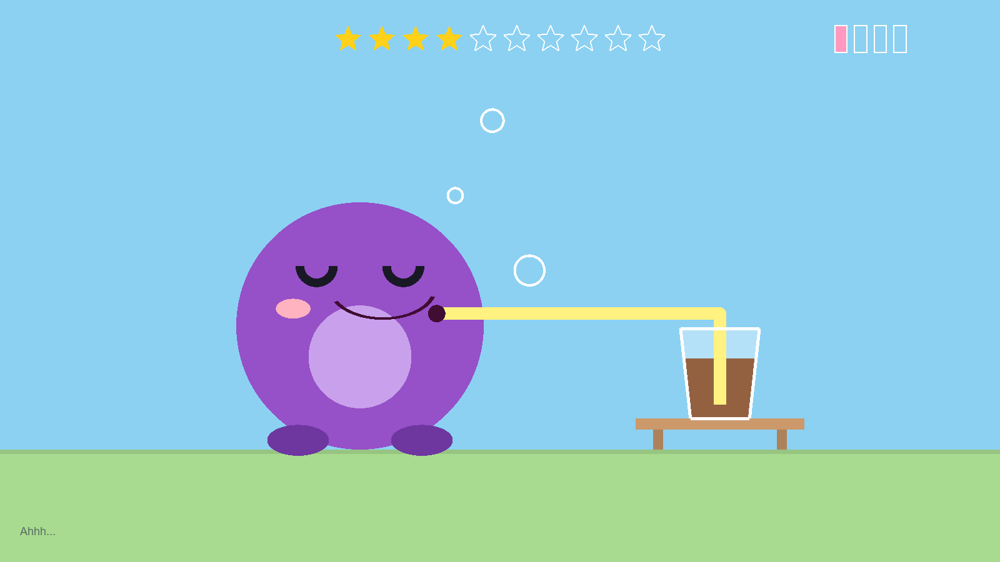 | **Ahhh.** When the slurp ends and counts, a third of the milkshake drains, bubbles rise and the belly goes down. After the third counted slurp the question comes; the child takes them at their own pace (6-8 s for three). |
| 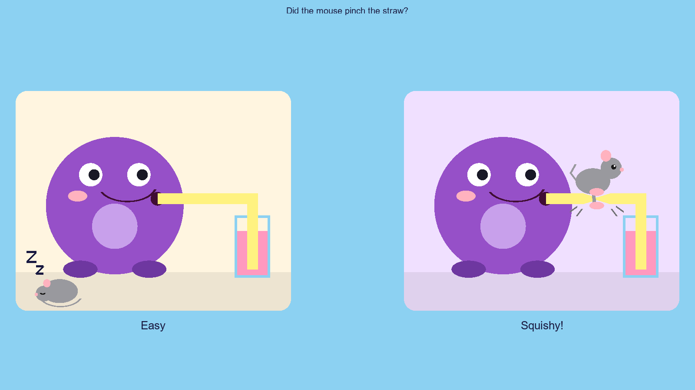 | **Question.** "Did the mouse pinch the straw?" Two equally bright scene cards: the mouse asleep ("easy") and the mouse pinching ("squishy"), a cheerful monster on both. The child says or points; the experimenter clicks that card. A white ring marks the card under the pointer. |
| 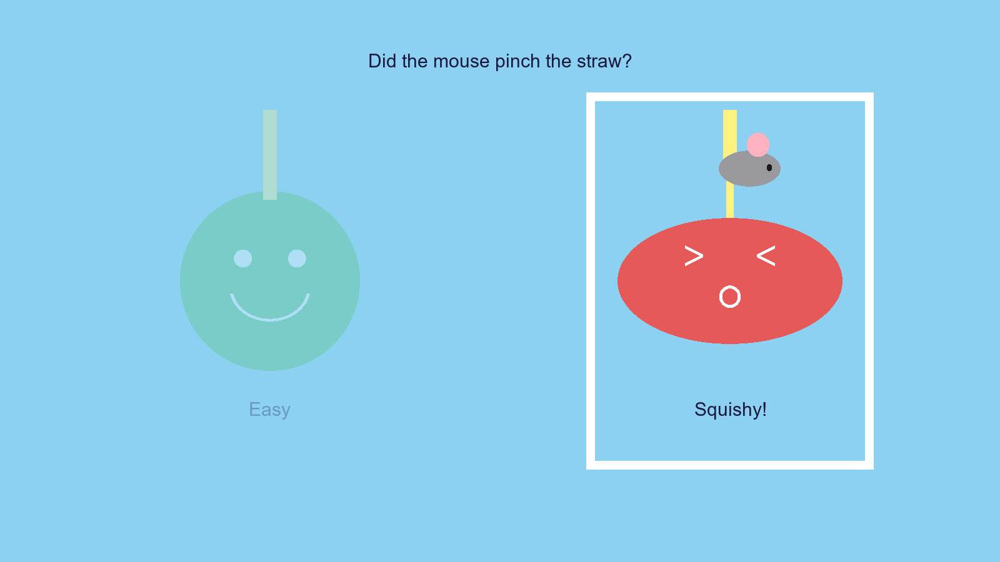 | **Answer registered.** The chosen card is framed and the other fades for 0.5 s. |
| 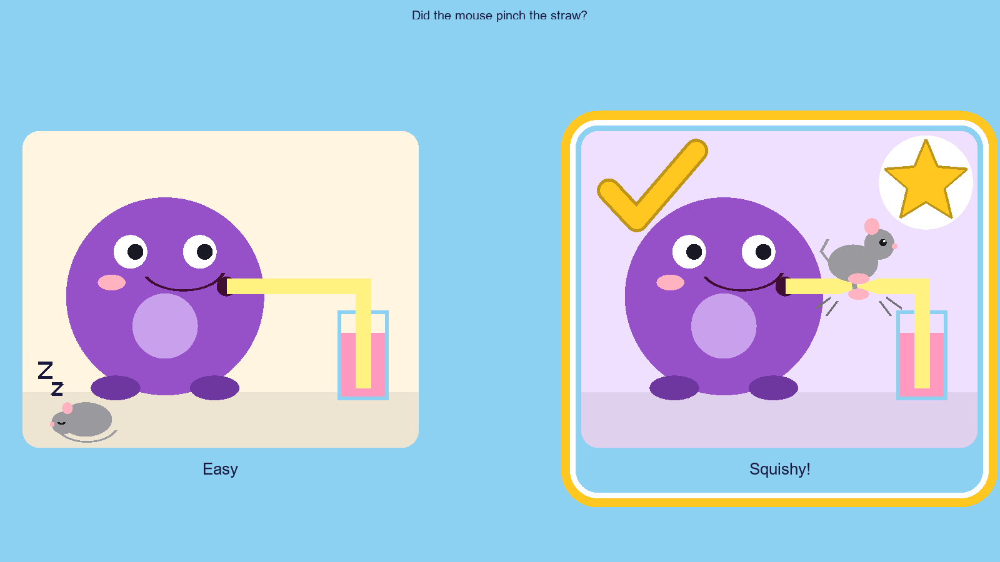 | **Practice reveal.** Practice only, after every answer: the truth for 1.5 s. On a loaded trial the mouse is shown pinching the straw, in a spotlight, with the scamper sound... |
| 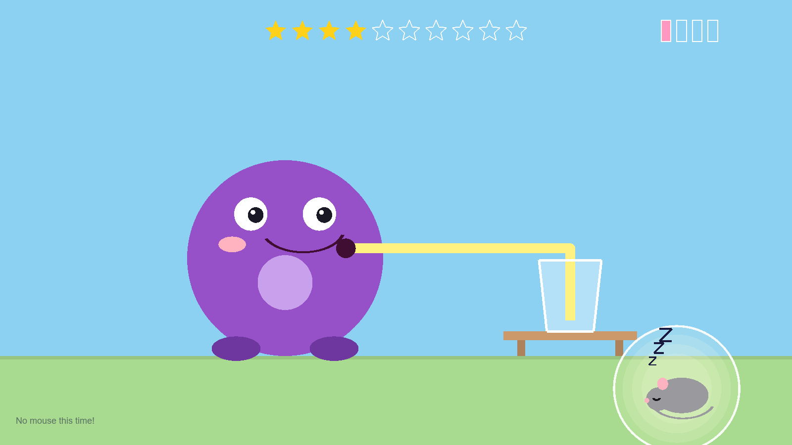 | **...and on a catch trial it is asleep under the table.** |
| 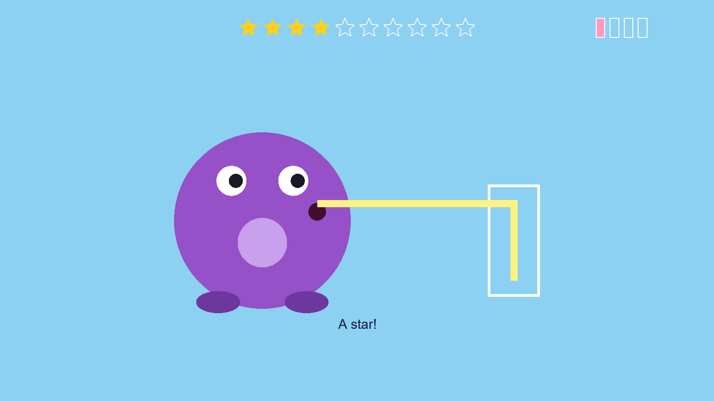 | **Star.** Main trials: for every answer, right or wrong, a star flies from the monster's belly into the next slot, with a sparkle. Stars count answers, not correct answers, so they are shown in every run. |
| 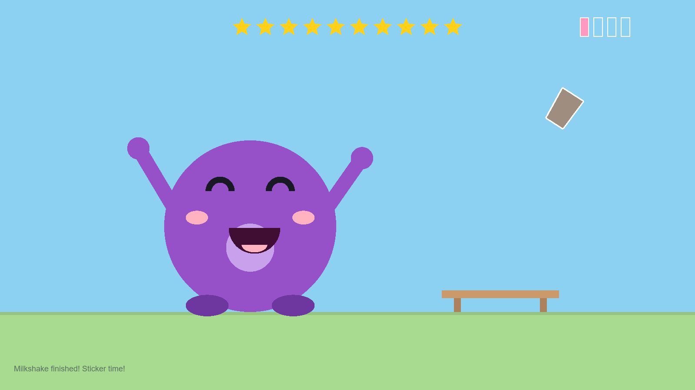 | **Cup finished.** The tenth star: the empty glass tips into the done row at the top right (fanfare), then the monster dances with its arms up and a new milkshake in the next flavour (pink, chocolate, mint, blueberry). Give a sticker, then Space. |
| 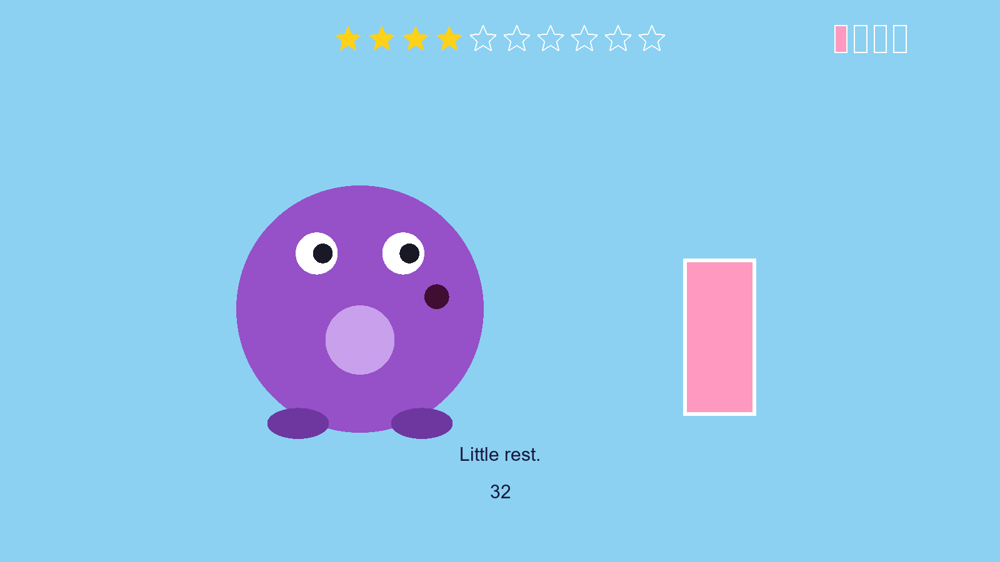 | **Rest.** Every 10 trials the monster naps (Z's) for 45 s while a bar drains; then it stretches, and "Ready to slurp?" comes back. Space goes on. |
| 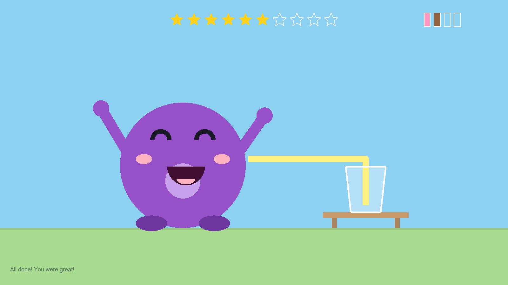 | **Done.** The monster celebrates. |

During the slurps the monster waits with an idle face (looking at the cup, blinking)
until the child inhales. A weak slurp gets the head-tilt "try again" pose while the
belly goes down; a time-out (8 s without a slurp) only prompts the experimenter, on
the console.

## Session

1. **Calibration**, before the child sits down: tube in, nobody on the mouthpiece. The
   wedge closes fully once (about 0.5 min).
2. **Story** (three beats), then the **tutorial**: free play (sets the reference
   slurp), the pinch demo at 80 and the sleep demo at 0 (three slurps each, no
   question, each followed by the reveal), the answer cards explained.
3. **Practice**: 6 trials (80, 0, 80, 0, 75, 0), each followed by the reveal, marked
   `PRACTICE k of 6` on the experimenter line. Pass: 5 of 6 right, including both 80s.
   The console prints every practice answer and, after each round, whether it passed
   and why not. One retry; a second failure ends the session as `PracticeFailed_`,
   which is itself a result.
4. **Main trials**: up to 40, a nap every 10. With breath-driven slurps a trial is
   about 12-15 s.
5. **Sticker.** About 12-20 minutes in all.

## Running it

**First, start the Physio Recorder** with the **RRST** preset and check the signals,
as for the adult task ([Running the 2.0 task](running.md),
[Recording physiology and airflow](../shared/recording.md)). The preset starts the
flow stream (`flow_lsl.py`); the task opens the `RRST` marker stream at launch and the
recorder starts recording when it appears. A real session holds before calibration
with **NOTHING IS RECORDING** until a recorder is connected.

**The airflow sensor is required by default.** At launch the task looks for the
`Flow` stream (10 s), reads it for 1 s with nobody breathing, and either prints
`Airflow sensor OK: 0.0 slm at rest` or stops with the problem and its fix (no
stream: start the Physio Recorder or `flow_lsl.py`; frozen, reversed, out of range or
constant flow: the message names the check). Nothing moves before this check passes.

```matlab
cd <repo>/task/RRST_kids
addpath('config');

% With the device (on the stim laptop it's COM7, through the USB hub) and the sensor
cfg = kidsConfig(); cfg.device.port = "COM7";
runKidsRRST(cfg)

% Without the airflow sensor: the timed animation, no breath feedback
cfg = kidsConfig(); cfg.device.port = "COM7";
cfg.flow.enabled = false; cfg.flow.feedback = "none";
runKidsRRST(cfg)

% Without a device or a child: simulated device, child and airflow, small window, 5x faster
cfg = kidsConfig(); cfg.device.mock = true; cfg.smallWindow = true;
cfg.debug.simulateChild = [70 8 0.1 0.1];   % [threshold slope falseAlarm lapse]
cfg.debug.timeScale = 0.2;
cfg.markers.lsl = false;                     % no LSL needed for a test run
runKidsRRST(cfg)
```

`cfg.flow.feedback = "none"` with the sensor on keeps the timed animation but still
records every slurp (the comparison run of the pilot protocol). MATLAB asks for the
child ID, then for Enter once the tube is in and nobody is on the mouthpiece
(calibration).

**Console** (the experimenter's view; the child sees none of it):

```
Airflow sensor OK: 0.0 slm at rest
Free slurp 1: 0.14 L, peak 11 slm (1 of 3; small, sets the reference).
Reference slurp 0.15 L (median of 6 free slurps: 0.13 L), peak 11 slm. Belly full at 0.06 L; a slurp counts above 0.10 L.
Slurp 1 counted: 0.18 L, peak 13 slm (1 of 3).
Slurp 2 too weak (0.06 L; a slurp counts from 0.10 L): not counted, try again.
No slurp seen for 8 s: mouthpiece in? Space = go on, x = repeat, Esc = abort
Slurp 3 lasted over 6 s: not counted. Flow is not returning to zero: check the circuit for a leak or a draught at the inlet.
Airflow stream lost: this trial finishes with the timed animation (flowLost). ...
Airflow stream is back.
```

If no free slurp was seen at all, the reference stays at 0.6 L and the console says
so in red: check the mouthpiece. A lost stream never stops the session: the trial
finishes with the timed animation and the task looks for the stream again before the
next trial.

**Experimenter controls**

| Input | Effect |
|---|---|
| Click a card (any button) | That answer. Clicks in the middle strip are ignored. |
| Left arrow / `n` | "Easy" (no) |
| Right arrow / `y` | "Squishy!" (yes) |
| `x` | Bad breath: the trial is repeated later (also during the slurps) |
| Space | Moves on from each story beat, "Ready to slurp?" and after the nap. During the slurps: go on to the question with the slurps so far (flagged `shortSlurps`; with none counted the trial is repeated later). During a question: pause (wedge to 0) |
| Esc | Abort: wedge parked open, data saved as `Aborted_` |

## Data

Saved to `data/raw/` (never committed): `RRSTkids_<ID>_<date>.mat` (every trial
including repeats, practice, the Psi posterior, flags, configuration, the device's
move log and transcript) and a `.csv` with one row per trial. Prefixes: `MOCK_`,
`SIM_`, `Aborted_`, `Error_`, `PracticeFailed_`.

Airflow per trial: in the `.mat`, `tr.slurps` holds every slurp the detector saw,
counted or not: `onsetT` and `endT` (GetSecs clock), `durationS`, `peakSlm`,
`volumeL`, `counted`, and `type` (`end` counted, `weak`, `overlong`, or `interrupted`
by Space or Esc). `vars.flowSource` says whether the flow was `live`, `simulated` or
`off`. The `.csv` adds `nSlurps` (counted slurps), `slurpVolumeL` and `slurpPeakSlm`
(means over the counted slurps, empty if none), `shortSlurps` (Space ended the slurps
before three counted) and `flowLost` (the stream was lost during the trial); `slurpT`
is the length of the slurp phase. The recorder's `.xdf` has the flow with a marker at
every slurp's onset and end (`slurp_<k>_onset`, `slurp_<k>_end_<L>_<slm>`,
`slurp_<k>_weak`, `slurp_<k>_overlong`).

For a QC figure (trials with the threshold estimate, P("squishy") with the fitted
curve, response times, summary):

```matlab
qcKids("data/raw/RRSTkids_9001_2026-10-28_1712.mat")
```

## Safety

- No level above `cfg.child.hardCap` (85 % of the adult scale at most) is ever sent.
  The configuration is rejected at start if any level is above the cap, and every
  level is checked again right before it goes to the device.
- Calibration closes the wedge fully: do it before the child sits down.
- Esc parks the wedge open; closing the port at the end disables the motor. The child
  can always take the mouthpiece out.

## First adult pilot (2026-10-28)

One adult tester, real device, 2 blocks (21 main trials, 5 catch), stopped with Esc.
Timed animation (before the breath feedback). Practice 6/6 right. Threshold 79.2 %
(SE 4.7), yes-bias 0.28, false alarms 2 of 5 catch trials. The "unusable" flag fired
on hits at 80 % (1 of 3), the misfire described below.

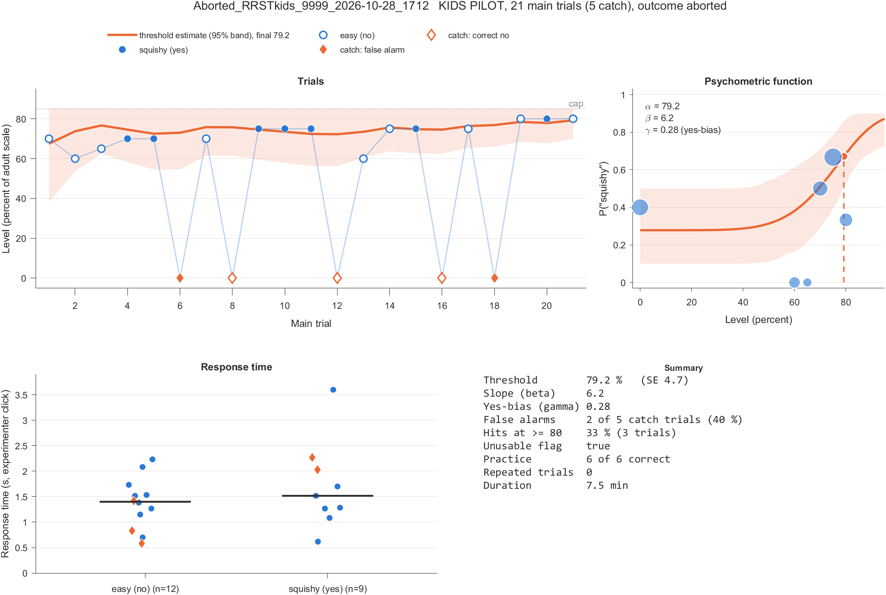

## First real run with feedback (2026-10-30, adult)

The experimenter, real device, breath feedback on, sensor live. "Very cute, huge
improvement." Every slurp was detected: 3 of 3 on every trial, 1.2 to 2.0 L and 83 to
137 slm per slurp, no weak slurp, no false onset. The run never reached the main
trials: practice round 1 failed at 80 % ("easy" answered twice at 80, both must-pass
trials), round 2 started, and the run was aborted from boredom. What went wrong was the
framing, not the detector:

- The experimenter did not know they were in practice, so the reveal ("the mouse was
  present / absent") made no sense: "it was not clear why it was telling me the mouse
  was present or absent if this is a no-feedback run".
- "It should say press space to continue when needed."
- "It's not clear what the stars represent or if they need to be shown on no-feedback
  runs."
- "We should build a quick intro tutorial."
- Three slurps took about 12 s per trial: the drain-and-bubbles animation after each
  slurp (1.8 s, the timed fallback's exhale) plus the breaths.

Changed in response: the experimenter line on every screen and the console
(`PRACTICE k of n`, `Trial n`, which key goes on), the tutorial (free play, the two
demos, the answer cards), stars explained above, and a 1.0 s drain
(`cfg.timing.drain`). Not changed: the practice levels, the pass rule and the cap.
An adult failing practice at 80 % is a design question (the first adult pilot's
threshold was 79 %, so 80 % is near threshold for an adult), now visible on the
console with the reason.

## Open questions

- **Does the breath feedback leak the level?** Peak flow and volume both fall with
  obstruction (bench 2026-10-28, one adult: 84 to 36 slm, 1.85 to 0.80 L between 0
  and 95 %). The belly saturates at 40 % of the reference slurp, so it fills on loaded
  slurps too, but it fills a little *slower* on them: that residual difference in fill
  speed could let a child answer from the picture. Check before any child sees the
  breath mode: an adult runs twice, feedback on (`cfg.flow.feedback = "breath"`) and
  off (`"none"`, sensor still recording), and compares catch-trial false alarms, the
  fitted guess rate, the threshold and its SE. A difference of more than two false
  alarms or a guess rate that moves by more than 0.15 calls for a second pair of runs
  (pilot protocol, Session A). `{{FLOW_FEEDBACK_MODE}}` stays "breath" unless that
  comparison says otherwise.
- **The minimum slurp for a child.** 25 % of the reference and at least 0.10 L are
  guesses; the first child's free slurps and weak count will tell.
- **The cap.** 85 % comes from one adult run. Children breathe with less flow, so the
  same obstruction gives less pressure drop; check 70-85 % on a flow rig. The adult
  tester's threshold was 79 %, close to the cap: a child whose threshold is above
  85 % cannot be measured, and what to report then is undecided.
- **The "low hit rate" flag misfires** for thresholds near 80 % (43 % of simulated
  children there were flagged). It should apply only when the estimated threshold is
  well below 80, or be dropped.
- **The false-alarm flag is noisy** with about 8 catch trials; more catch trials or a
  rule based on the estimated guess rate would be steadier.
- Translations (Swiss German, Danish). The cue sounds' loudness over the rain is still
  to be checked by ear. The lag from breath to screen is still to be measured
  (`TODO(measure)` in [Airflow sensor](../shared/airflow-sensor.md#live-feedback-check)).
